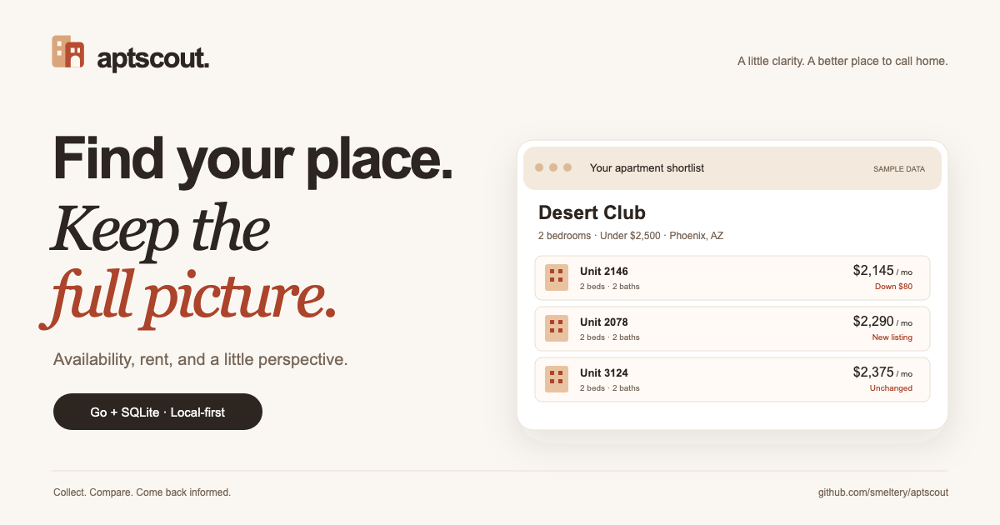

#  aptscout

Apartment listings change. Keep the full picture.



[](https://github.com/smeltery/aptscout/actions/workflows/ci.yml)
[](https://github.com/smeltery/aptscout/releases)
[](LICENSE)


[](.flox/env/manifest.toml)


Collect apartment availability, filter by budget and bedrooms, and track rent changes in a local SQLite database. Use the Go CLI or its embedded browser UI. No account required. The included provider supports **Desert Club Apartments in Phoenix**; additional properties can be added through providers.

## Get started

Install a [release binary](https://github.com/smeltery/aptscout/releases), or use Go 1.26.1+:

```sh
go install github.com/smeltery/aptscout@latest
aptscout scrape
aptscout list --beds 2 --max-price 2500
aptscout serve --open
```

## Documentation

Start in [docs/](docs/README.md): [installation](docs/quick-start.md), [commands](docs/commands.md), [web UI](docs/web-ui.md), [data and history](docs/data.md), [providers](docs/providers.md), and [troubleshooting](docs/troubleshooting.md).

For development, activate [Flox](https://flox.dev), then run `bun run ci`. See [development](docs/development.md) for setup, pre-commit hooks, website commands, and automatic releases.

Licensed under [PolyForm Shield 1.0.0](LICENSE).
