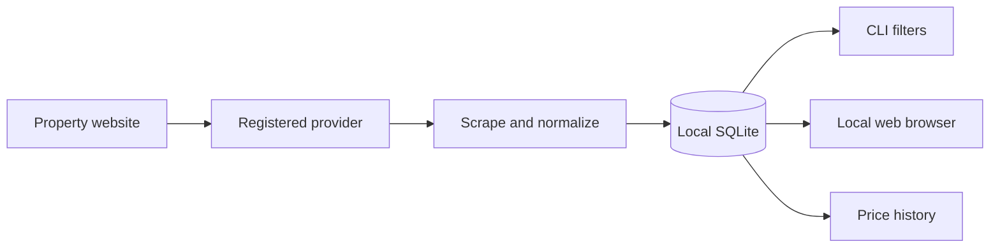

# Overview

Apartment availability, with a memory. aptscout collects listings from supported properties, keeps them in SQLite, and lets you compare units from a terminal or local browser.

## A smaller apartment search

Run a scrape when you want fresh listings. Filter by bedrooms, budget, floor plan, or move-in date. Open a unit's history to see the prices captured by your previous scrapes. No account or hosted database is required.

The included provider supports **Desert Club Apartments in Phoenix**. The provider architecture supports adding other properties; it does not scrape arbitrary apartment URLs.

## How it works

Only a successful scrape updates availability for its property. Prices are observations from scrape time, not a guarantee of current rent. Always confirm terms and availability with the property.

## Start here

- [Quick start](quick-start.md): install and collect your first listings.
- [Commands](commands.md): filters, history, statistics, and cleanup.
- [Web UI](web-ui.md): browse saved apartments visually.
- [Data and history](data.md): understand storage and availability.
- [Providers](providers.md): supported properties and extensions.
- [Troubleshooting](troubleshooting.md): recover from common problems.
- [Development](development.md): Flox, checks, hooks, and releases.
