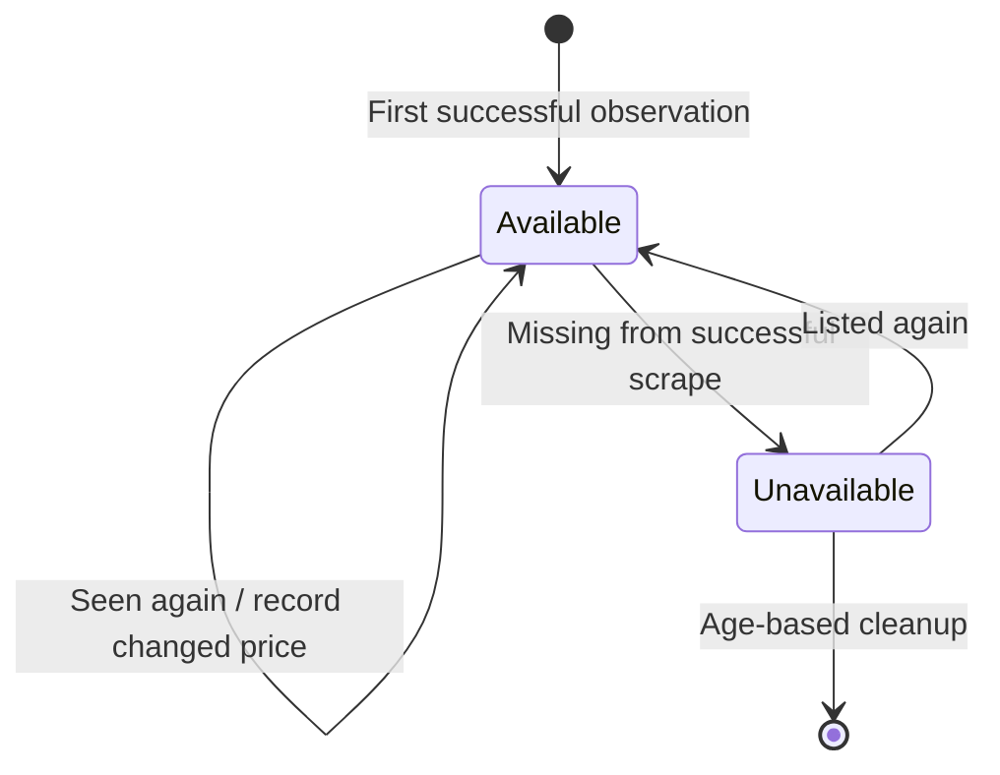

# Data and history

Your observations stay in a local SQLite database at `~/.local/share/aptscout/aptscout.db`, including on macOS. Override it with `--db PATH`.

## What is stored

| Table           | Contents                               |
| --------------- | -------------------------------------- |
| `floor_plans`   | Property-specific plan metadata        |
| `apartments`    | Unit details, prices, and availability |
| `price_history` | Initial prices and later price changes |
| `scrape_runs`   | Timing, counts, and scrape failures    |

Property IDs scope units and floor plans, so identical unit numbers at different properties can coexist.

## Availability lifecycle

Missing units become unavailable after a successful scrape. A failed scrape is not evidence that units disappeared. History only covers observations you collected; aptscout cannot reconstruct earlier prices.

## Back up or move

Stop the server and other aptscout processes before copying the database. SQLite can use adjacent `-wal` and `-shm` files while a connection is active; copying only the main file while it is open may miss recent data. For a live backup, use SQLite's backup command instead of a raw file copy.

Store backups outside the repository. Restore to a new path and inspect it with `aptscout --db PATH stats` before replacing your working database.

## Retention

Nothing is automatically deleted on a schedule. `aptscout clean --days N` removes stale units across the database. A dry-run reports the threshold, not a record count. Keep a backup if you need a durable record before cleanup.
